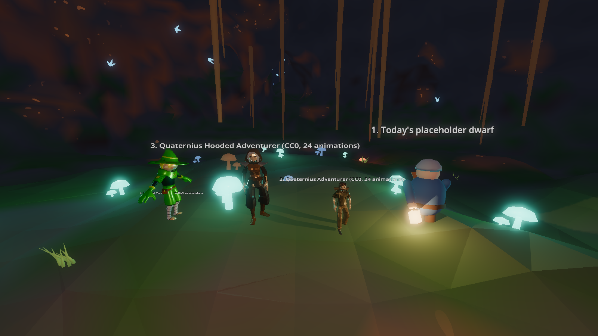
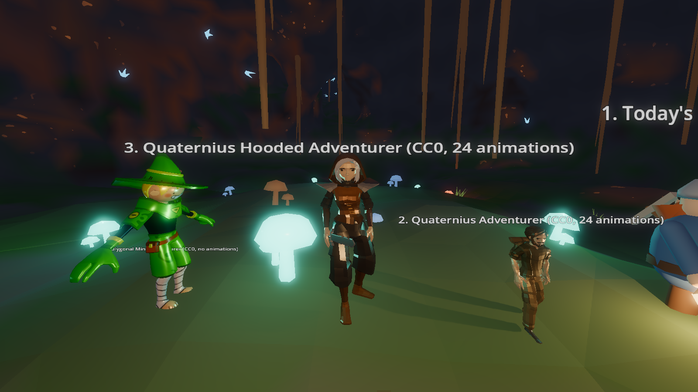
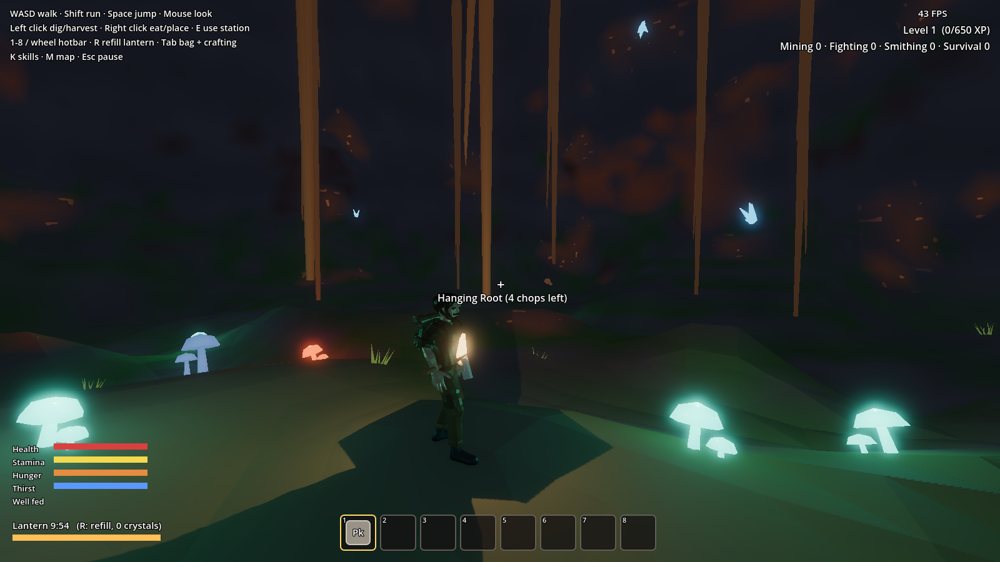

# Picking the art style (Step 1 to-do)

The plan says: Claude tries free art, you pick from screenshots. Here are the first candidates.
All are **CC0** (free for anything, including selling the game).




| # | What | Animations | Notes |
|---|---|---|---|
| 1 | Today's dwarf (made of simple shapes) | Simple swings only | Chunky, bright. Ours, so no license worries. |
| 2 | **Quaternius "Adventurer"**, squashed to dwarf shape | **24**: idle, walk, run, roll, sword slash, punch, hit, death… | Already has a **beard** and a backpack. **Claude's pick.** |
| 3 | Quaternius "Hooded Adventurer" | Same 24 | Looks more like a rogue than a dwarf. |
| 4 | Polygonal Mind "Adventurer" | None | Cute cartoon look, but no animations (would need work). |

**Try #2 in the game** (the build on branch `step-7-ready` or later):

```
"%GODOT%" --path . -- art=quaternius
```



Notes:
- With `art=quaternius`, the dwarf really walks, runs, rolls when you dodge, and swings with the model's
  own animations. It's a first try: the lantern looks a bit stretched and tool positions need tuning.
- Monsters and stations are still simple shapes. Quaternius also has CC0 monster and prop packs we can try next.
- Where these came from: poly.pizza (models by Quaternius and Polygonal Mind, CC0). See `CREDITS.md`.

**Tell Claude:** "use 1", "use 2", or "find more options".
