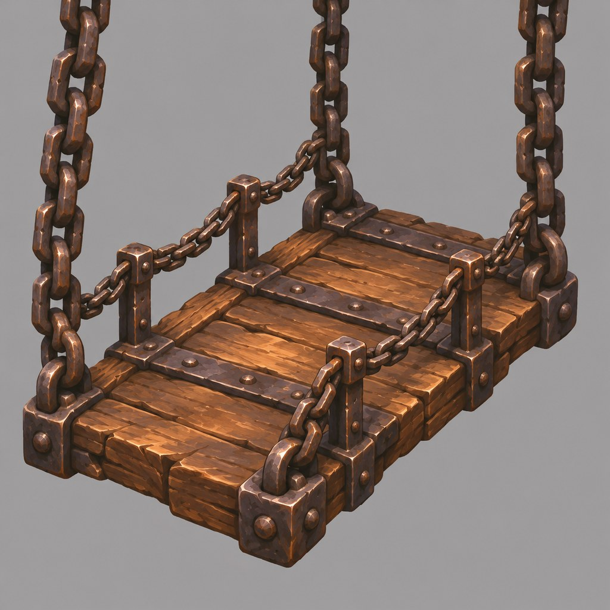

# Chain bridge section (`bridge_chain_section`)

**Dungeons:** ⭐ Cinderhold Foundry (Chain Bridge).
**What it does:** a bridge section that drops on its chains and rises again. **Clue:** the chains go slack with a clank before it drops. **Safe way:** wait on the solid part until it rises.

## Size (2 m grid)
- **2 m wide × 2 m long**, planks 0.12 m thick; 4 corner chains up to 6 m; hand chains 1 m tall.

## Parts and what moves
| Part name | What it is | Moves? |
|---|---|---|
| `deck` | planks, iron bands, hand chains | **drops** 3 m in 0.5 s (tilts 20° on one side first), rises in 4 s |
| `chains` | the 4 corner chains | pay out with the deck (code stretches them by adding links) |

## Start from
- `dungeon_rootwood.py` `bridge()` planks + `chain()`.

## Colours
- Wood: root-wood bark and planks (Shack `shackbark`, `shackplank`, `shacklogend`), rope picture, dark iron.
- Forge: dark iron, soot-stained brick and stone, brass only as small trim; molten metal = the existing glow colour.

## MODEL-RULES checks that matter
- **Rule 1:** built by script; side-by-side picture with this concept before it's done.
- **Rule 2 (no shimmer):** moving parts keep at least 1 cm clear of the fixed parts in every position (check the start and the end pose).
- **FLOAT:** every part touches the rest (chain links touch each other, rivets touch plates).
- Two sections end to end leave a 1 cm gap (no shimmer at the joint).

## Picture vs. this sheet
The picture is concept art for the look only. Sizes, parts and doors follow this sheet (whole 2 m squares, the existing round door).
