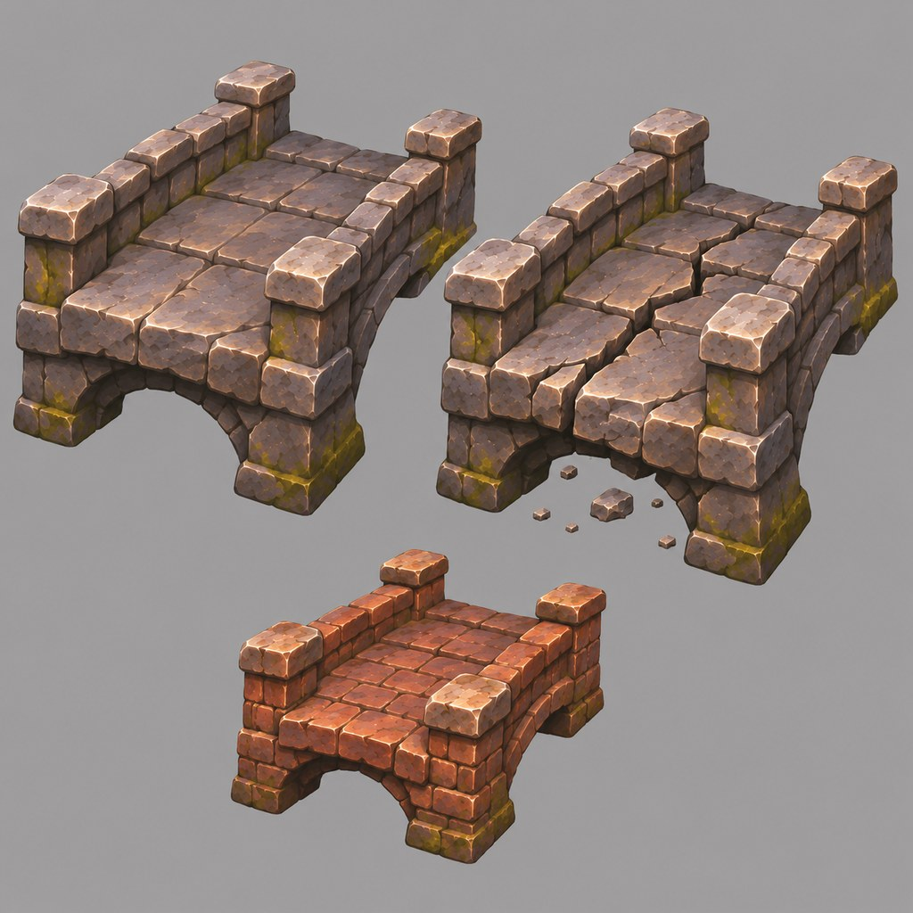

# Stone and brick bridge slabs + cracked (`bridge_slab__cut_stone`, `__clay_brick`, `_cracked`)

**Dungeons:** Tomb (⭐ cracked stone bridge, Bridge of Oaths), Barrows, Shieldbearers, Vigil, Cinderhold.
**What it does:** bridge slabs; the cracked one falls away when walked on. **Clue:** a dark jagged crack, chips missing underneath. **Safe way:** walk on the uncracked slabs.

## Size (2 m grid)
- **2 m wide × 2 m long**, 0.35 m thick; low parapets 0.5 m tall on both sides; tiles along its length.

## Parts and what moves
| Part name | What it is | Moves? |
|---|---|---|
| `slab` | the slab (whole one: stays) | stays |
| `piece0..2` | cracked one: 3 pieces split along the crack | **fall** one by one (code) |
| `parapet` | the parapets | stay |

## Start from
- `stonehold_v2.py` floor blocks + railing; brick: `kit_zone1.py` `clay_brick`. Crack pattern: `dungeon_rootwood.py` `crack_line()`.

## Colours
- Stone: Stonehold cut stone (4 grey tones, dark mortar), dark iron bands.
- Brick: Hearthbrick warm red-brown bricks (4 tones, dark mortar), pale limestone trim, dark iron.

## MODEL-RULES checks that matter
- **Rule 1:** built by script; side-by-side picture with this concept before it's done.
- **Rule 3 (building piece):** clean layers (backing, material, trim, decor); nothing past the outline; outer faces 0.5 cm inside it; lines up with the kit's normal piece beside it (picture of both).
- **Rule 2 (no shimmer):** parts that sit on each other are joined or 1 cm apart; decals 1 cm above the floor.
- **Rule 6:** neighbouring planks, stones or bricks use different paintings; nothing stretched.
- Pieces of the cracked slab keep a 1 cm crack gap between them.

## Picture vs. this sheet
The picture is concept art for the look only. Sizes, parts and doors follow this sheet (whole 2 m squares, the existing round door).
