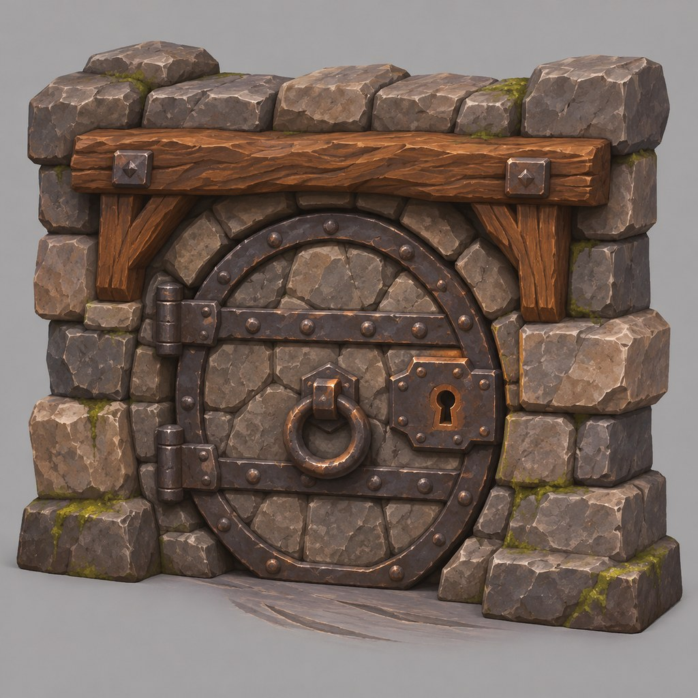

# Locked round door, stone and brick (`door_locked_round__cut_stone`, `door_locked_round__clay_brick`) + 9 keys

**Dungeons:** #5 to #12 (the locked doors and gates; the boss or mini boss holds the key).
**What it does:** stays shut until a dwarf holding that dungeon's key uses it. Then it swings open and stays open
for everyone in co-op. **Clue:** the keyhole glints copper. No trap, no hurt.

## Size (2 m grid)
- A normal **2 m wide × 2 m tall × 0.3 m deep** wall piece (the doorway), same outline as the building kit's doorway.
- The door: a **round door, radius 0.78 m, centre 0.70 m above the floor, cut flat at the floor** (Rule 5).
  Door slab 0.14 m thick (thicker than the wood door, it's stone).
- Lock plate 0.24 × 0.24 m on the right, keyhole centre at 0.72 m up (dwarf hand height).

## Parts and what moves
| Part name | What it is | Moves? |
|---|---|---|
| `frame` | the wall piece with the round opening, lintel, the door's stop ring | stays |
| `door` | stone slabs, iron bands, rivets, lock plate, ring handle | **swings** on its left hinges: pivot line at x = −0.74 m, z = 0.02 m (front face), vertical. Opens **inward by 100°** in 1.2 s |
| `ring` | the iron ring handle | swings down on its staple: pivot at the staple, 0° to 35° (lifts when used) |
| `keyhole_glint` | a small copper ring round the keyhole (own material so the game can make it glow faintly) | stays |

## The 9 keys (`tr_key_<name>`)
Recolours and small reshapes of `assets/models/treasure/tr_key_copper.glb` / `tr_key_iron.glb` (built by
`treasure.py`): Barrow (bone-pale iron), Rune (stone bow with a carved rune), Bronze, Vault (big, gold-brass),
Armoury (iron, shield-shaped bow), Forge (black iron, hammer bow), Gear (brass, cog bow), Hammer (iron, hammer bow,
bigger), Foundry (dark copper, crucible bow). Same size as the copper key; only the bow (the round end) changes shape.

## Start from
The round doorway and the round door shape **already exist** (building kit + `loot_door()`): reuse them exactly. Only
the door's face (stone slabs or brick-red iron, lock, ring) is new. The picture is concept art for the look.
- Stone: `tools/asset_forge/builds/stonehold_v2.py` `doorway()` (round opening, blocks, timber lintel, `DOOR_R`,
  `DOOR_CY`). Brick: `kit_zone1.py` `doorway()` with `clay_brick` (bricks, pale limestone keystone round the arch).
- Door: `dungeon_rootwood.py` `loot_door()` (iron bands, lock plate, keyhole, ring): swap the planks for 3-4
  chisel-cut stone slabs (stone) or a plank door faced with brick-red painted iron (brick version, keep it calm).

## Colours
- **Stone:** Stonehold cut stone, 4 grey tones, dark mortar, warm timber lintel; dark iron bands; copper keyhole ring.
- **Brick:** Hearthbrick warm red-brown bricks, pale limestone round the arch and keystone; dark wood door with dark
  iron bands; copper keyhole ring. One main colour family each, accents about 1 in 8 (Rule 3).

## MODEL-RULES checks that matter
- **Rule 5:** a real circle cut flat at the floor, r 0.78 m, centre 0.70 m. Picture with the door shut and open.
- **Rule 3 (building piece):** clean layers (backing, stone/brick, trim, iron decor), nothing outside the 2 × 2 m
  outline, lines up with the kit's normal wall beside it (picture of the two side by side).
- **Rule 2:** the shut door leaves a 1 cm gap to the stop ring; bands sit 1 cm proud or are joined; outer faces 0.5 cm
  inside the piece's outline.
- **FLOAT:** rivets, lock plate and ring touch the door.
- **Rule 1 / Rule 6:** built by script; each stone slab a different painting.
