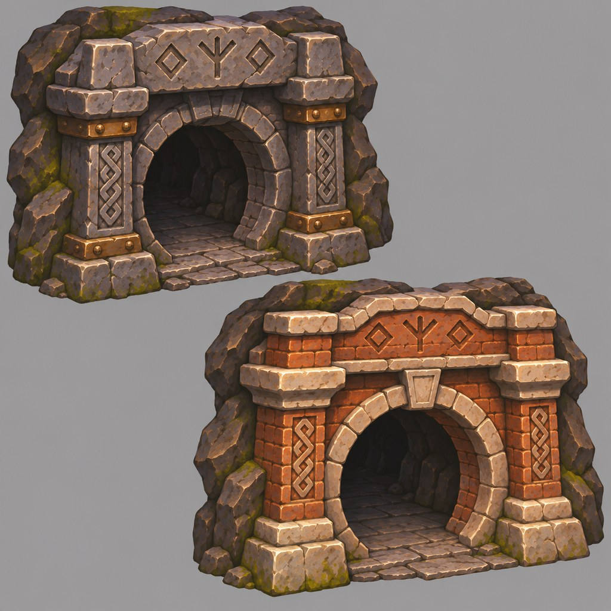

# Dungeon entrance, stone and brick (`dungeon_entrance__cut_stone`, `__clay_brick`)

**Dungeons:** #5 to #12 (the wood one exists for #1 to #4).
**What it does:** the front door frame in the cave wall.

## Size (2 m grid)
- Same as the wood `dungeon_entrance`: **3 m wide × 3 m tall** around the **existing round doorway** (2 × 2 m piece inside it).
- Rune lintel at 2.45 m, like the wood one.

## Parts and what moves
| Part name | What it is | Moves? |
|---|---|---|
| `frame` | pillars, lintel, rune stone | stays |
| `door` | the existing round door of that style | swings like the normal door |

## Start from
- `dungeon_rootwood.py` `entrance()` layout; `stonehold_v2.py` / `kit_zone1.py` doorway inside, unchanged; `rune_slab.py` runes.

## Colours
- Stone: Stonehold cut stone (4 grey tones, dark mortar), dark iron bands.
- Brick: Hearthbrick warm red-brown bricks (4 tones, dark mortar), pale limestone trim, dark iron.
- Runes: carved, the rune glow colour faint.

## MODEL-RULES checks that matter
- **Rule 1:** built by script; side-by-side picture with this concept before it's done.
- **Rule 3 (building piece):** clean layers (backing, material, trim, decor); nothing past the outline; outer faces 0.5 cm inside it; lines up with the kit's normal piece beside it (picture of both).
- **Rule 5:** the doorway is the existing round one (reuse it, don't redraw it).
- **Rule 6:** neighbouring planks, stones or bricks use different paintings; nothing stretched.

## Picture vs. this sheet
The picture is concept art for the look only. Sizes, parts and doors follow this sheet (whole 2 m squares, the existing round door).
