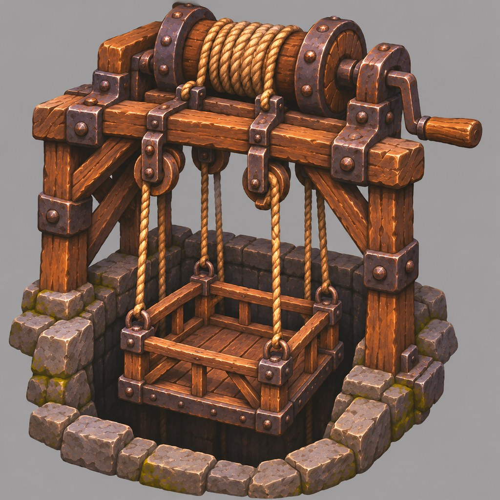

# Rope lift + winch (`lift_platform`, `lift_winch`)

**Dungeons:** Old Pell's Diggings (rope lift), Emberdeep Forge (old ore lift); ways out.
**What it does:** carries everyone back up to the entrance.

## Size (2 m grid)
- Platform: **2 × 2 m**, 0.2 m thick, railing 1 m tall on 3 sides. Winch frame: 2 × 2 m, 2.5 m tall over the shaft top.

## Parts and what moves
| Part name | What it is | Moves? |
|---|---|---|
| `platform` | planks, railing, 4 rope ends | **rises** along y with the code (any height) |
| `winch` | frame + drum + crank | drum **turns** round x while the lift moves; crank turns with it |
| `ropes` | 4 ropes | the code stretches them between platform and winch |

## Start from
- `dungeon_rootwood.py` `bridge()` planks, logs, lashings; `rope()` helper; drum from `barrel_box.py`.

## Colours
- Wood: root-wood bark and planks (Shack `shackbark`, `shackplank`, `shacklogend`), rope picture, dark iron.

## MODEL-RULES checks that matter
- **Rule 1:** built by script; side-by-side picture with this concept before it's done.
- **Rule 2 (no shimmer):** moving parts keep at least 1 cm clear of the fixed parts in every position (check the start and the end pose).
- **FLOAT:** every part touches the rest (chain links touch each other, rivets touch plates).
- The platform clears the shaft walls by 5 cm on every side.

## Picture vs. this sheet
The picture is concept art for the look only. Sizes, parts and doors follow this sheet (whole 2 m squares, the existing round door).
