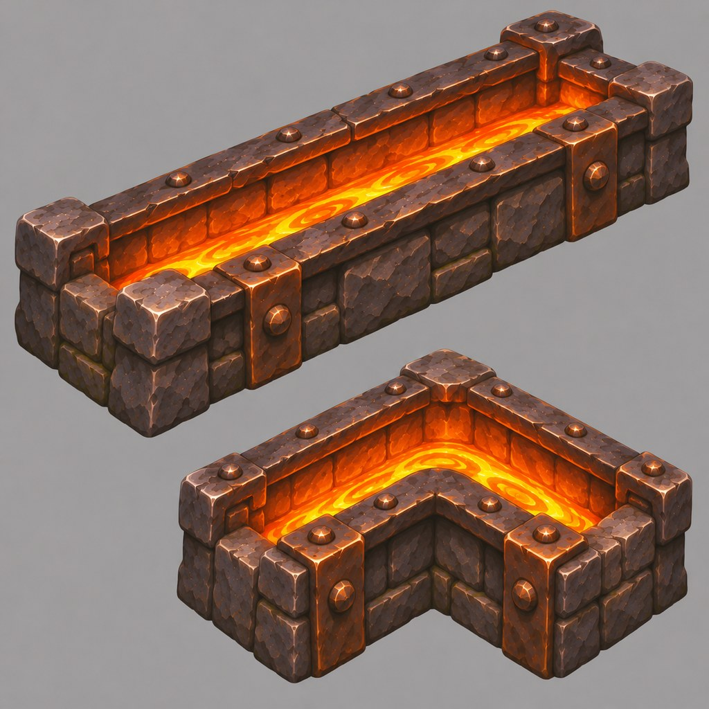

# Molten channel, straight and corner (`molten_channel`, `molten_channel_corner`)

**Dungeons:** Emberdeep (⭐ Quench Hall), Hammerfall (Molten Channel), Cinderhold.
**What it does:** molten metal flows in deep stone channels; falling in kills like spikes. It can never spill. **Clue:** glow and heat shimmer. **Safe way:** jump the narrow parts, cross the bridges.

## Size (2 m grid)
- **2 × 2 m floor pieces**: channel 1 m wide, metal 0.5 m below the rim; rim stones 0.5 m wide each side with an iron edge.

## Parts and what moves
| Part name | What it is | Moves? |
|---|---|---|
| `stone` | channel walls and rim | stays |
| `metal` | the metal surface (its own material, the code scrolls its texture) | stays (texture flows) |

## Start from
- `stonehold_v2.py` blocks, soot-darkened; metal surface: the existing molten glow material.

## Colours
- Forge: dark iron, soot-stained brick and stone, brass only as small trim; molten metal = the existing glow colour.
- Stone: Stonehold cut stone (4 grey tones, dark mortar), dark iron bands.

## MODEL-RULES checks that matter
- **Rule 1:** built by script; side-by-side picture with this concept before it's done.
- **Rule 3 (building piece):** clean layers (backing, material, trim, decor); nothing past the outline; outer faces 0.5 cm inside it; lines up with the kit's normal piece beside it (picture of both).
- **Rule 2 (no shimmer):** parts that sit on each other are joined or 1 cm apart; decals 1 cm above the floor.
- Pieces join end to end and at corners with the metal surfaces lined up and 1 cm apart (no shimmer).
- Owner: molten metal stays inside stone channels: no open edge anywhere.

## Picture vs. this sheet
The picture is concept art for the look only. Sizes, parts and doors follow this sheet (whole 2 m squares, the existing round door).
