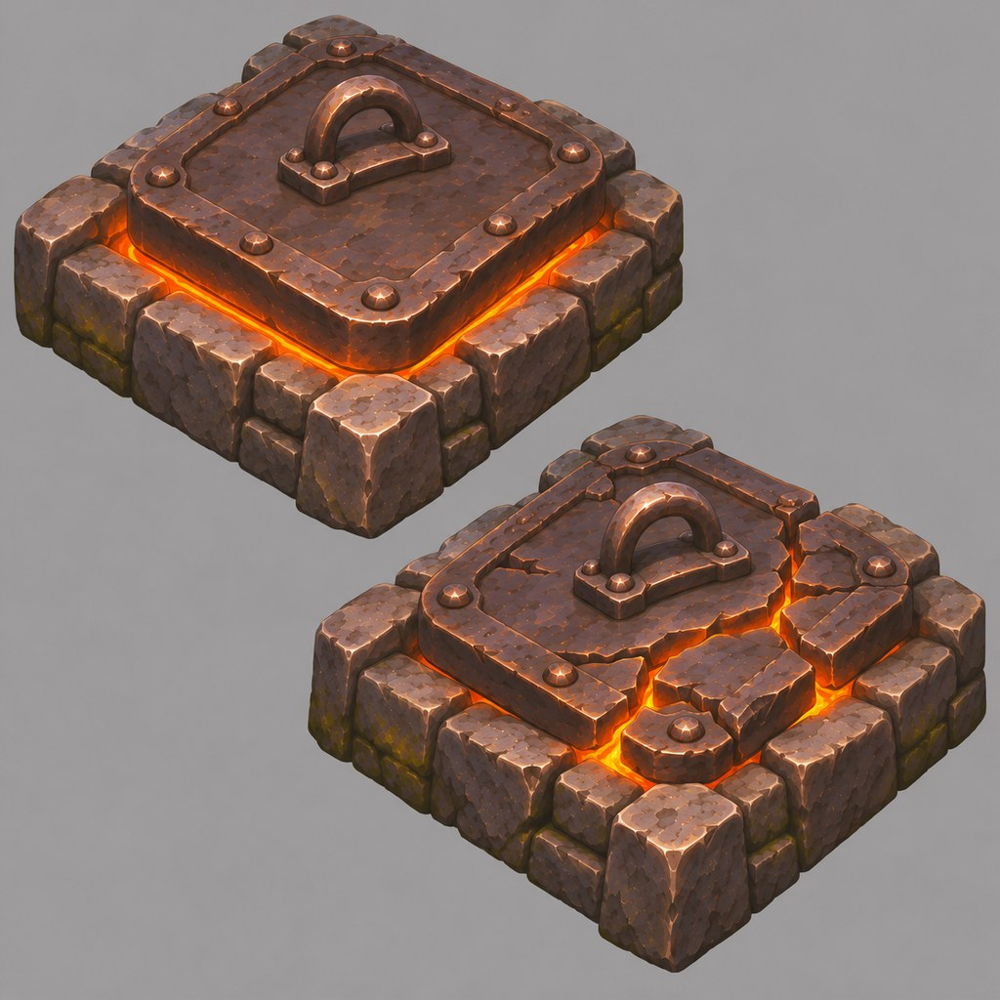

# Casting mould + lid + cracked lid (`mould_pit`, `mould_lid`, `mould_lid_cracked`)

**Dungeons:** Cinderhold Foundry (⭐ Casting Floor: molten moulds).
**What it does:** moulds of molten metal under iron lids; cracked lids break when you step on them. **Clue:** orange glow through the cracks. **Safe way:** step only on whole lids.

## Size (2 m grid)
- `mould_pit`: a **2 × 2 m floor piece** with a 1.4 × 1.4 m pit, metal 0.4 m down.
- `mould_lid`: 1.5 × 1.5 m iron lid, 0.1 m thick, sitting 1 cm above the floor; ring handle.

## Parts and what moves
| Part name | What it is | Moves? |
|---|---|---|
| `pit` | the pit and its stone rim | stays |
| `lid` | whole lid | stays |
| `lid_piece0..3` | cracked lid: 4 pieces | **fall in** when stepped on, 0.3 s, and sink |

## Start from
- `stonehold_v2.py` floor; lid from `loot_door()` iron bands (flat).

## Colours
- Forge: dark iron, soot-stained brick and stone, brass only as small trim; molten metal = the existing glow colour.
- Cracks: dark with an orange glow line inside.

## MODEL-RULES checks that matter
- **Rule 1:** built by script; side-by-side picture with this concept before it's done.
- **Rule 3 (building piece):** clean layers (backing, material, trim, decor); nothing past the outline; outer faces 0.5 cm inside it; lines up with the kit's normal piece beside it (picture of both).
- **Rule 2 (no shimmer):** parts that sit on each other are joined or 1 cm apart; decals 1 cm above the floor.
- Lid pieces keep 1 cm gaps; the metal never reaches the floor level.

## Picture vs. this sheet
The picture is concept art for the look only. Sizes, parts and doors follow this sheet (whole 2 m squares, the existing round door).
