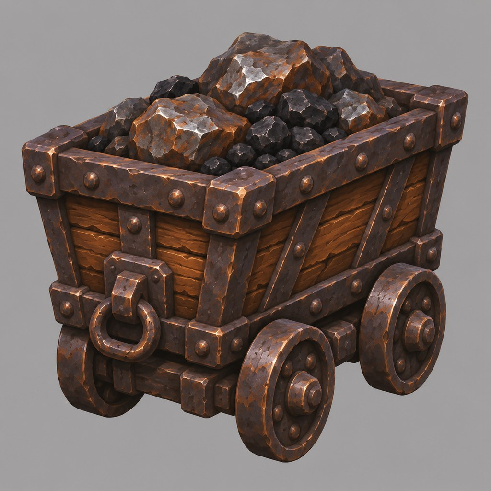

# Forge ore cart (`ore_cart`)

**Dungeons:** The Hammerfall Works (Ore Cart Ramp); Emberdeep / Cinderhold as decor.
**What it does:** the big dungeons' version of the mine cart; it runs on the triple rails. **Clue:** (the rail rattle). **Safe way:** (see the triple rail set).

## Size (2 m grid)
- 1.0 m long × 0.8 m wide × 0.75 m tall, fits the 0.44 m rail gauge (same wheels spacing as `mine_cart`).
- Heavier look than `mine_cart`: it hits as a ragdoll + big hit.

## Parts and what moves
| Part name | What it is | Moves? |
|---|---|---|
| `body` | iron-plated wooden box, rivets, ore heap | moves along the rail (the whole model) |
| `wheel0..3` | 4 chunky iron wheels | **spin** round their axle (x axis), 1 turn per 1.4 m travelled |

## Start from
- `night_decor.py` `mine_cart()`: scale up, add iron plates and corner bands, swap the stone heap for ore + coal lumps.

## Colours
- Forge: dark iron, soot-stained brick and stone, brass only as small trim; molten metal = the existing glow colour.
- Ore heap: dark ore with a few copper-green and rust lumps, black coal.

## MODEL-RULES checks that matter
- **Rule 1:** built by script; side-by-side picture with this concept before it's done.
- **Rule 2 (no shimmer):** parts that sit on each other are joined or 1 cm apart; decals 1 cm above the floor.
- **FLOAT:** every part touches the rest (chain links touch each other, rivets touch plates).
- Wheels: separate parts with their centre on the axle, so spinning doesn't wobble.

## Picture vs. this sheet
The picture is concept art for the look only. Sizes, parts and doors follow this sheet (whole 2 m squares, the existing round door).
