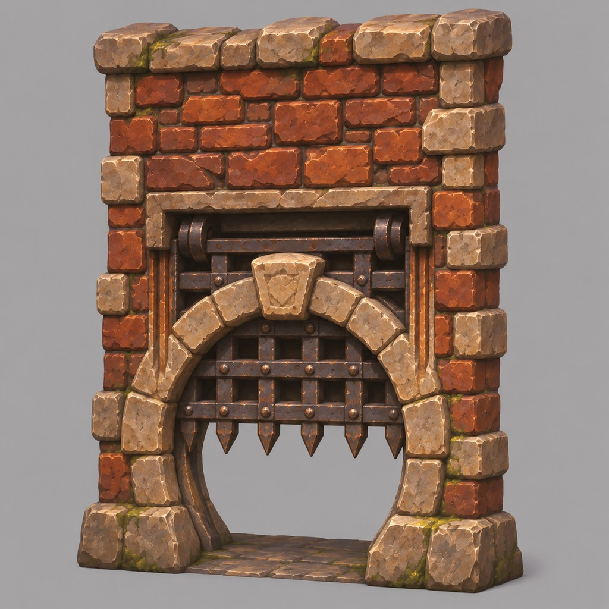

# Dropping portcullis, stone and brick (`portcullis__cut_stone`, `portcullis__clay_brick`)

**Dungeons:** Tomb of Hald Ironbrow (Key Chapel), Brassgate Vault (Captain's Quarters), Hall of the Shieldbearers
(Sergeant's Quarters), The Hammerfall Works (Smelter's Hall), Cinderhold Foundry (Crucible Hall).
(The wood version is the existing `gate_round`.)
**What it does:** you walk into the mini boss's room, the gate slams down behind you and creatures pour in.
**Clue:** worn vertical grooves on both sides of the doorway. **Safe way:** wedge it with a rock or plank before it
drops (it stops 0.5 m up and you can crawl out), or win the fight. When the room is won it slides back up.

## Size (2 m grid)
- A **tall wall piece: 2 m wide × 4 m tall × 0.6 m deep** (two wall pieces high), so the raised gate hides inside it.
- Doorway: **the existing round doorway** of the building kit (copy it, don't redraw it) at the bottom, **radius 0.78 m, centre 0.70 m, cut flat at the floor** (Rule 5).
- Slot above the doorway: 1.65 m wide, 0.14 m deep, running up to 3.9 m inside the wall (hidden from the front
  except a thin dark slit).
- Gate: a round grate the doorway's shape plus 5 cm all round (so it covers the opening), bars 7 cm thick.

## Parts and what moves
| Part name | What it is | Moves? |
|---|---|---|
| `frame` | the brick/stone wall, limestone (or dark stone) arch blocks and keystone, the slot, the grooves | stays |
| `gate` | iron bars, cross bars, rivets, pointed tips | **slides straight down** along y: up position = bottom of the bars at 1.55 m (fully hidden), down = bar tips 2 cm above the floor. Drops 1.53 m in 0.35 s (slam), rises in 3 s. Wedged stop: 0.5 m up |
| `grooves` | two worn vertical channels either side, 1 cm deep | stays (part of the frame's surface, not a decal) |

## Start from
- Brick: `tools/asset_forge/builds/kit_zone1.py` `doorway()` + `arch_ring()` with `clay_brick` (bricks, pale
  limestone voussoirs and keystone), stretched to 4 m tall with a plain brick wall section on top.
- Stone: `stonehold_v2.py` `doorway()` + `gateway()` (the 4 m stone gateway) for the tall block wall.
- Gate: `dungeon_rootwood.py` `gate_round()` (the round bar gate): swap root-wood bars for dark iron bars and add
  sharpened tips at the bottom.

## Colours
- **Brick:** Hearthbrick warm red-brown bricks in 4 tones, dark mortar, pale limestone arch and keystone.
- **Stone:** Stonehold cut stone, 4 grey tones, dark mortar, a darker stone arch.
- Gate: dark iron (`gate_round_iron` look), slightly rusty tips. The slot inside is the dark backing colour.

## MODEL-RULES checks that matter
- **Rule 5:** the opening is the real round door shape; picture with the gate up and down.
- **Rule 3 (building piece):** clean layers; the slot is cut cleanly through the brick layer (bricks cut exactly to
  its edge); nothing past the 2 × 4 m outline; lines up with two normal kit walls stacked beside it.
- **Rule 2:** the gate bars stay at least 1 cm from the slot's walls in every position (it slides, so check up and
  down); bars that cross are stacked (front bars 1 cm in front), never through each other.
- **FLOAT:** every bar touches its cross bars; rivets touch the bars.
- **Rule 1 / Rule 6:** built by script; neighbouring bricks clearly different paintings.

## Picture vs. this sheet
The sheet wins. The picture is concept art only. Its wall reads about 1.5 grid squares wide, which is wrong:
the piece is exactly **1 square wide × 2 squares tall (2 m × 4 m)**. The picture's slot sits open on the front and its grate is square: build the slot hidden inside the
wall (only a thin dark slit shows) and the grate in the round door's shape.
