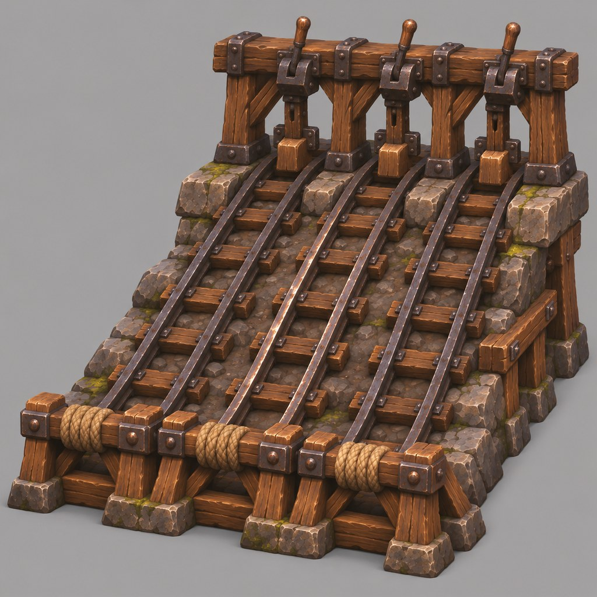

# Triple rail tunnel set (`rail_triple`, `rail_buffer`, `rail_release`)

**Dungeons:** ⭐ Lampwick Drift (Cart Junction), The Hammerfall Works (Ore Cart Ramp, faster).
**What it does:** 3 rails side by side; carts run down each lane in a pattern. **Clue:** a rattle before each cart; the next lane's rails glint (worn). **Safe way:** learn the pattern and stand in the empty lane.

## Size (2 m grid)
- `rail_triple`: **2 m wide (one square) × 2 m long**, tiles along its length; 3 lanes 0.66 m apart, rail gauge 0.44 m like `rail_track`. A sloped version drops 0.5 m per 2 m.
- `rail_buffer`: 2 × 1 m, buffer stops 0.6 m tall at the low end.
- `rail_release`: 2 × 1 m frame, 1.6 m tall, at the high end.

## Parts and what moves
| Part name | What it is | Moves? |
|---|---|---|
| `rails` | sleepers, 6 rails, spikes | stays |
| `chock0..2` | one wooden chock per lane in the release frame | **flips** up 80° round its back edge to let a cart go (0.2 s) |
| `lever0..2` | a lever per lane on the frame | swings 40° forward with its chock (looks only) |
| `bumper0..2` | rope-wrapped bumper per lane | pushes back 10 cm when hit, springs back |

## Start from
- `night_decor.py` `rail_track()` (sleepers, rails) ×3 side by side; `mine_cart()` stays the cart.
- Release frame and buffers: `dungeon_rootwood.py` logs, lashings, pegs; `lever()` for the levers.

## Colours
- Wood: root-wood bark and planks (Shack `shackbark`, `shackplank`, `shacklogend`), rope picture, dark iron.
- Rails: iron; one rail per lane painted brighter on the top edge (the worn glint).

## MODEL-RULES checks that matter
- **Rule 1:** built by script; side-by-side picture with this concept before it's done.
- **Rule 2 (no shimmer):** moving parts keep at least 1 cm clear of the fixed parts in every position (check the start and the end pose).
- **FLOAT:** every part touches the rest (chain links touch each other, rivets touch plates).
- **Rule 6:** neighbouring planks, stones or bricks use different paintings; nothing stretched.
- Tiling: two `rail_triple` end to end must line up with no gap and no doubled sleeper.

## Picture vs. this sheet
The picture is concept art for the look only. Sizes, parts and doors follow this sheet (whole 2 m squares, the existing round door).
