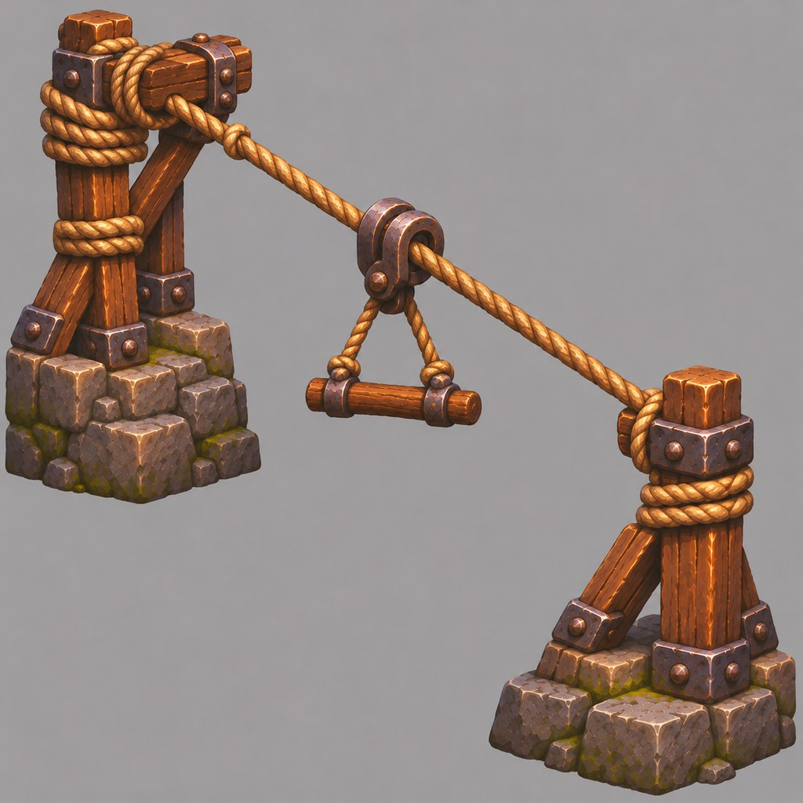

# Rope slide (`rope_slide`)

**Dungeons:** Mossprop Workings (from the Top Hall down to Base Camp); a way out.
**What it does:** slide down a rope on a handle bar.

## Size (2 m grid)
- Two anchor posts, 1.8 m tall, on 2 × 2 m bases; the rope between them is placed by the code (any length).
- Handle bar 0.6 m wide on a pulley.

## Parts and what moves
| Part name | What it is | Moves? |
|---|---|---|
| `anchor_top`, `anchor_bottom` | posts, lashings | stay |
| `rope` | the rope | stretched by the code |
| `handle` | pulley + bar | **slides** along the rope with the player |

## Start from
- `dungeon_rootwood.py` logs, `rope()`, lashings.

## Colours
- Wood: root-wood bark and planks (Shack `shackbark`, `shackplank`, `shacklogend`), rope picture, dark iron.

## MODEL-RULES checks that matter
- **Rule 1:** built by script; side-by-side picture with this concept before it's done.
- **FLOAT:** every part touches the rest (chain links touch each other, rivets touch plates).
- The rope ends touch their posts' lashings (FLOAT).

## Picture vs. this sheet
The picture is concept art for the look only. Sizes, parts and doors follow this sheet (whole 2 m squares, the existing round door).
