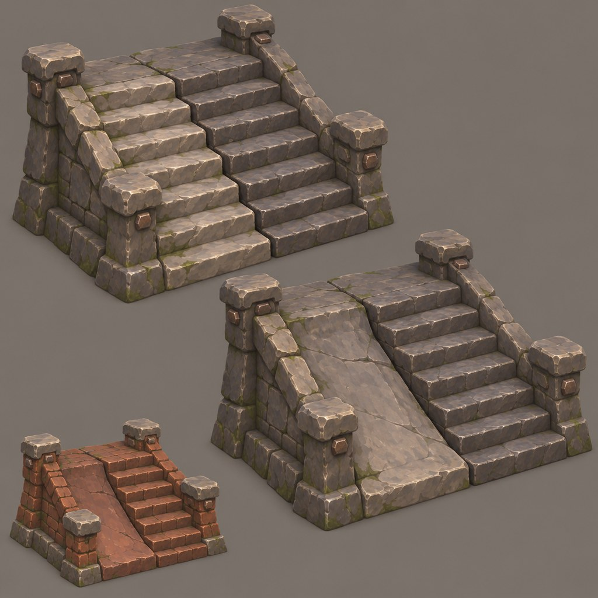

# Collapsing double stairs, stone and brick (`stairs_collapsing__cut_stone`, `__clay_brick`)

**Dungeons:** ⭐ Tomb of Hald Ironbrow (Broken Stair), Cinderhold Foundry (Ash Stair, brick).
**What it does:** one half of the double-wide stairs flattens into a slide into spikes. Deadly. **Clue:** that half is a very faint different colour; a thin gap at its edge. **Safe way:** walk on the right half.

## Size (2 m grid)
- **4 m wide (2 squares) × 2 m tall × 2 m deep**, 5 steps (like the kit's `stairs`).
- Left half 2 m: the trap steps. Right half 2 m: normal steps.
- Thin gap between the halves: 1.5 cm, dark.

## Parts and what moves
| Part name | What it is | Moves? |
|---|---|---|
| `stairs` | the right half + the side walls | stays |
| `trap_steps` | the left half's 5 steps | **fold down** into a smooth slope: each step's front edge drops so the top surface becomes one 45° slab, 0.3 s |
| `slide` | the smooth slope shape (hidden inside, shown when sprung) | appears when the steps fold |

## Start from
- `stonehold_v2.py` `stairs()` and `kit_zone1.py` `stairs()` with `clay_brick`, two side by side.

## Colours
- Stone: Stonehold cut stone (4 grey tones, dark mortar), dark iron bands.
- Brick: Hearthbrick warm red-brown bricks (4 tones, dark mortar), pale limestone trim, dark iron.
- Trap half: the same family, **one step lighter and a touch warmer**. Very faint: the owner wants it findable, not obvious.

## MODEL-RULES checks that matter
- **Rule 1:** built by script; side-by-side picture with this concept before it's done.
- **Rule 3 (building piece):** clean layers (backing, material, trim, decor); nothing past the outline; outer faces 0.5 cm inside it; lines up with the kit's normal piece beside it (picture of both).
- **Rule 2 (no shimmer):** moving parts keep at least 1 cm clear of the fixed parts in every position (check the start and the end pose).
- **Rule 6:** neighbouring planks, stones or bricks use different paintings; nothing stretched.
- Colour check by eye: put the picture next to a normal stair; the difference should need a second look.

## Picture vs. this sheet
The picture is concept art for the look only. Sizes, parts and doors follow this sheet (whole 2 m squares, the existing round door).
