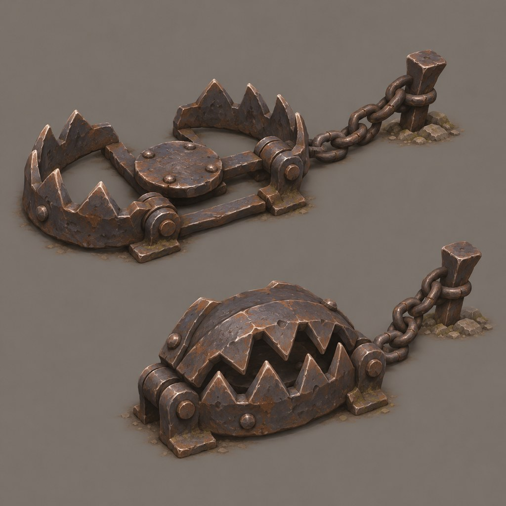

# Bear jaw trap, open and shut (`trap_bear_jaws`)

**Dungeons:** Lampwick (Old Copper Face), Pell's (Sorting Room), Barrows (Keeper's Corridor), Shieldbearers (Training Yard), Emberdeep (Coal Store), Cinderhold (Slag Heap).
**What it does:** iron jaws grab your leg for a few seconds. **Clue:** a rusty glint in the dust. **Safe way:** look down; a friend can pry it open.

## Owner's rules (Nov 20)
- Just the black iron trap: **no chain and no wooden stake**.
- It lies about in **different rooms** (not only in rubble), on the floor.
- **Only a player** sets it off (creatures walk over it).
- Stepping on it does **25 damage** (and it grabs the leg, as below).

## Size (2 m grid)
- 0.86 m across (the bar), 0.7 m jaws; shut: jaws 0.3 m tall. No chain, no stake (owner, Nov 20).

## Parts and what moves
| Part name | What it is | Moves? |
|---|---|---|
| `base` | the bar, hinge blocks, springs, the round plate under the trigger | stays |
| `jaw_l`, `jaw_r` | the two jaws | **snap shut**: each turns 90° up round its hinge (x axis, at the plate's edge), 0.08 s; open again in 1 s when pried |
| `plate` | the trigger plate | sinks 1 cm when stepped on |

## Start from
- `tools/asset_forge/builds/dungeon_mine.py` `trap_bear_jaws()`.

## Colours
- Rusty dark iron with bright worn teeth tips; a dusty grey layer on top (open version) so it blends with the floor.

## MODEL-RULES checks that matter
- **Rule 1:** built by script; side-by-side picture with this concept before it's done.
- **Rule 2 (no shimmer):** moving parts keep at least 1 cm clear of the fixed parts in every position (check the start and the end pose).
- **FLOAT:** every part touches the rest (chain links touch each other, rivets touch plates).
- Shut: the teeth interlock 1 cm apart, never through each other.

## Picture vs. this sheet
The picture is concept art for the look only. Sizes, parts and doors follow this sheet (whole 2 m squares, the existing round door).
