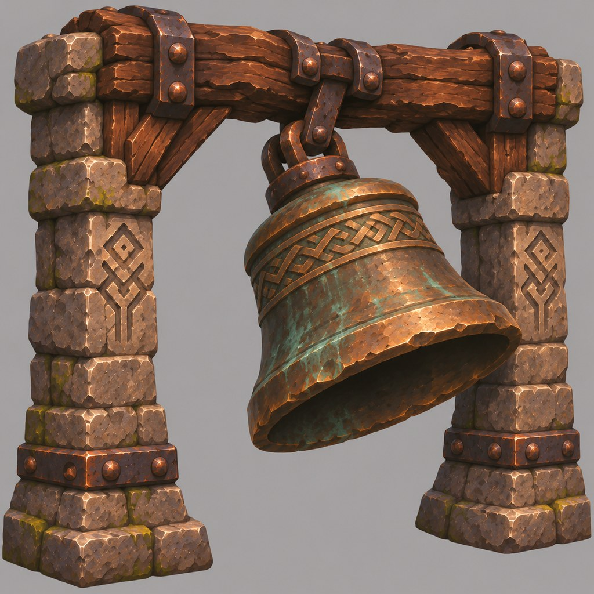

# Bell pendulum (`trap_bell_pendulum`)

**Dungeons:** ⭐ Vigil of Orrin Stonejaw only (Hall of Echoes).
**What it does:** giant bells with sharp rims swing across the hall like pendulums. **Clue:** they ring before each swing; deep cuts in the floor. **Safe way:** time the gaps, or shoot a bell's rope.

## Size (2 m grid)
- Frame: **4 m wide × 6 m tall × 1 m deep** (the hall is 12 × 12 m, taller).
- Bell: 1.6 m across the rim, 1.6 m tall; rim 0.4 m above the floor at the low point.

## Parts and what moves
| Part name | What it is | Moves? |
|---|---|---|
| `frame` | two rune-carved stone pillars, a heavy wooden yoke beam | stays |
| `swing` | rope + bell (the clapper inside is its own part) | **swings** ±45° across the path, pivot at the yoke (0, 5.7 m, 0) |
| `clapper` | the clapper | swings inside the bell ±20° (rings) |
| `cuts` | deep floor cuts (decal) | stays |

## Start from
- Pillars: `stonehold_v2.py` blocks + `rune_slab.py` runes. Yoke: `dungeon_rootwood.py` logs. Bell: a lathe-turned shape by script.

## Colours
- Stone: Stonehold cut stone (4 grey tones, dark mortar), dark iron bands.
- Bell: bronze with green verdigris in the hollows; rim edge brighter. Runes: the rune glow colour.

## MODEL-RULES checks that matter
- **Rule 1:** built by script; side-by-side picture with this concept before it's done.
- **Rule 2 (no shimmer):** moving parts keep at least 1 cm clear of the fixed parts in every position (check the start and the end pose).
- **FLOAT:** every part touches the rest (chain links touch each other, rivets touch plates).
- **Placement rule:** nothing the cave grows may stand in its moving area; add a keep-out test when it's placed.
- The rope is the shootable part: build it as its own piece so it can be cut.

## Picture vs. this sheet
The picture is concept art for the look only. Sizes, parts and doors follow this sheet (whole 2 m squares, the existing round door).
