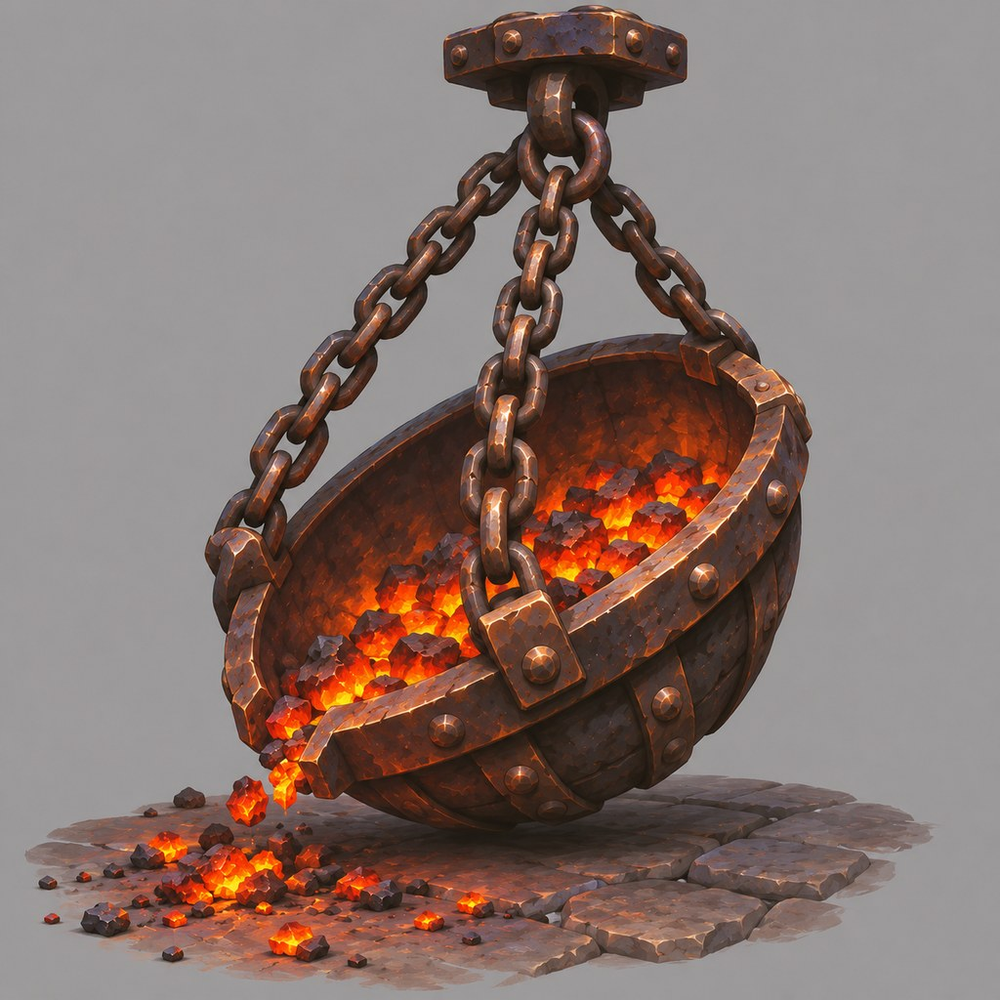

# Tipping brazier + spilled embers (`trap_brazier_tip`, `embers_spill`)

**Dungeons:** Emberdeep (Soot Corridor, Furnace Gallery), Hammerfall (Furnace Undercroft), Cinderhold (Smelter Row, Tapping Hall).
**What it does:** a big bowl of hot coals on chains tips and spills embers over the floor. Burns. **Clue:** glowing coals, creaking chain. **Safe way:** shoot the chain so it tips early, then wait until the embers go dark.

## Size (2 m grid)
- Bowl: 1.4 m across, 0.5 m deep, hanging so its bottom is 2.2 m above the floor; 3 chains up to one ceiling hook (ceiling 4 m).
- `embers_spill`: a 2 × 2 m floor decal of scattered lumps, 1-2 cm high.

## Parts and what moves
| Part name | What it is | Moves? |
|---|---|---|
| `hook` | ceiling plate + hook | stays |
| `bowl` | the bowl, coals, 2 of the chains | **tips** 110° round the third chain's ring (pivot on the bowl rim), 0.6 s |
| `chain_shot` | the one chain you can shoot | breaks free when shot |
| `embers_spill` | ember lumps; their glow material fades to grey in the code | stays |

## Start from
- Chains: `dungeon_rootwood.py` `chain()`; bowl: `cooking_pot.py` / `campfire.py` coals; no pack model.

## Colours
- Forge: dark iron, soot-stained brick and stone, brass only as small trim; molten metal = the existing glow colour.
- Coals: glowing orange centres, dark grey edges. Embers: the same, smaller; a 'dark' version for after.

## MODEL-RULES checks that matter
- **Rule 1:** built by script; side-by-side picture with this concept before it's done.
- **Rule 2 (no shimmer):** moving parts keep at least 1 cm clear of the fixed parts in every position (check the start and the end pose).
- **FLOAT:** every part touches the rest (chain links touch each other, rivets touch plates).
- No flames anywhere (owner: medieval, no fire jets).

## Picture vs. this sheet
The picture is concept art for the look only. Sizes, parts and doors follow this sheet (whole 2 m squares, the existing round door).
