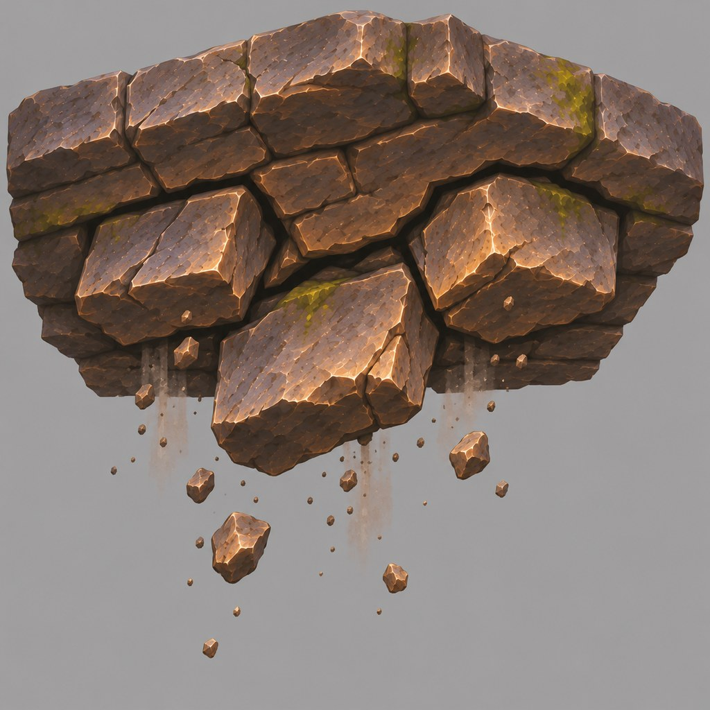

# Falling ceiling stones (`trap_ceiling_stones`)

**Dungeons:** Tomb (Statue Corridor), Barrows (Spiral Stair), Vigil (First Stair) and #5-#9 generally.
**What it does:** the stone version of the falling stalactites: loose ceiling blocks drop one by one. **Clue:** dark cracks round the blocks, dust falling. **Safe way:** (same as the stalactites) run under quickly or wait for them to fall.

## Size (2 m grid)
- A **2 × 2 m ceiling piece**, 0.4 m thick; 3 loose blocks 0.6-0.8 m each.

## Parts and what moves
| Part name | What it is | Moves? |
|---|---|---|
| `ceiling` | the ceiling slab | stays |
| `stone0..2` | the 3 loose blocks | **fall** one by one, biggest first (code drops them) |

## Start from
- `dungeon_traps.py` `build_cluster()` (the falling-part pattern) + `stonehold_v2.py` stone blocks.

## Colours
- Stone: Stonehold cut stone (4 grey tones, dark mortar), dark iron bands.
- Cracks: very dark; one block hangs 2 cm lower (the clue).

## MODEL-RULES checks that matter
- **Rule 1:** built by script; side-by-side picture with this concept before it's done.
- **Rule 3 (building piece):** clean layers (backing, material, trim, decor); nothing past the outline; outer faces 0.5 cm inside it; lines up with the kit's normal piece beside it (picture of both).
- **Rule 2 (no shimmer):** parts that sit on each other are joined or 1 cm apart; decals 1 cm above the floor.
- Each loose block stays 1 cm clear of the slab round its crack.

## Picture vs. this sheet
The picture is concept art for the look only. Sizes, parts and doors follow this sheet (whole 2 m squares, the existing round door).
