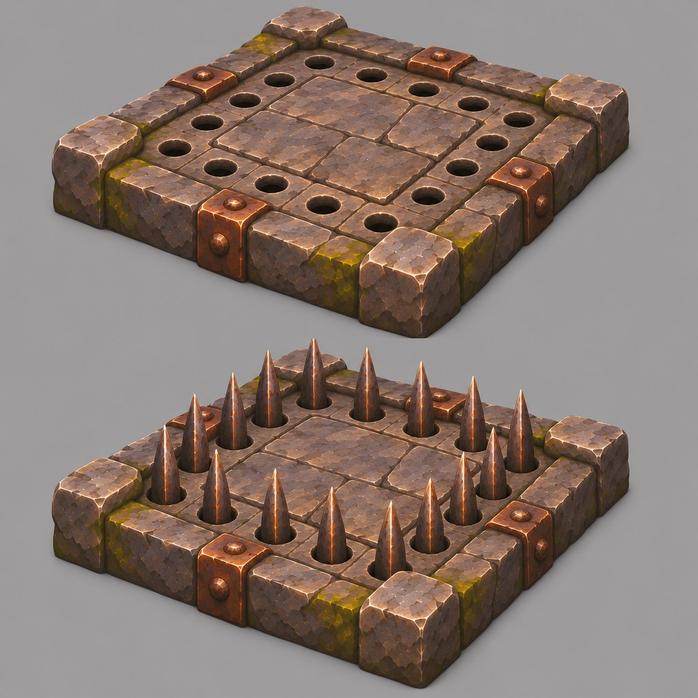

# Spike-hole floor plate for trapped chests (`trap_chest_spikes`)

**Dungeons:** Every trapped chest (most dungeons; 2 in Brassgate Vault).
**What it does:** spikes shoot up from floor holes round the chest when you open it. Hurts. **Clue:** spike holes in the floor round it. **Safe way:** shoot the chest with a crossbow: the spikes come up and go back, then open it.

## Size (2 m grid)
- A **2 × 2 m floor piece**, same height as the normal floor; 12 holes in a ring 0.9 m from the centre. Spikes 0.6 m tall.

## Parts and what moves
| Part name | What it is | Moves? |
|---|---|---|
| `floor` | the floor with holes | stays |
| `spikes` | 12 spikes (iron or wood stakes) | **slide up** along y: −0.62 → 0 m in 0.12 s, back down in 1 s |

## Start from
- `dungeon_traps.py` `build_spikes()` (stakes, tips) for the spikes; the style's floor piece for the plate (wood, stone, brick versions).

## Colours
- Wood: root-wood bark and planks (Shack `shackbark`, `shackplank`, `shacklogend`), rope picture, dark iron.
- Stone: Stonehold cut stone (4 grey tones, dark mortar), dark iron bands.
- Brick: Hearthbrick warm red-brown bricks (4 tones, dark mortar), pale limestone trim, dark iron.

## MODEL-RULES checks that matter
- **Rule 1:** built by script; side-by-side picture with this concept before it's done.
- **Rule 3 (building piece):** clean layers (backing, material, trim, decor); nothing past the outline; outer faces 0.5 cm inside it; lines up with the kit's normal piece beside it (picture of both).
- **Rule 2 (no shimmer):** moving parts keep at least 1 cm clear of the fixed parts in every position (check the start and the end pose).
- The chest's own spot (0.9 × 0.6 m in the middle) stays flat and clear.

## Picture vs. this sheet
The picture is concept art for the look only. Sizes, parts and doors follow this sheet (whole 2 m squares, the existing round door).
