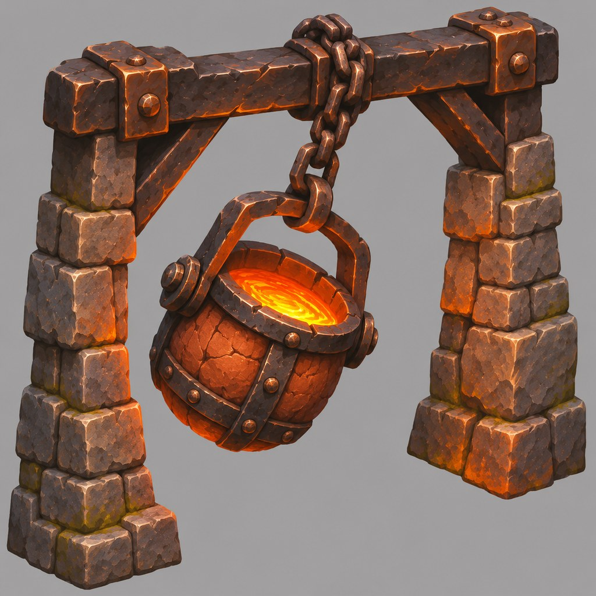

# Swinging crucible (`trap_crucible_swing`)

**Dungeons:** Emberdeep Forge (⭐ Crucible Bridge), Cinderhold Foundry (First Bridge: knocks you off).
**What it does:** a big crucible of molten metal swings across a bridge. Knocks you off; the metal stays inside. **Clue:** the orange glow sweeps across, chain creak. **Safe way:** time it.

## Size (2 m grid)
- Frame: **4 m wide × 5 m tall** over the 2 m bridge. Crucible 1.2 m across, 1 m tall; bottom 0.6 m above the deck at the low point.

## Parts and what moves
| Part name | What it is | Moves? |
|---|---|---|
| `frame` | iron beam, stone supports | stays |
| `swing` | chain + crucible + metal | **swings** ±55° across the bridge, pivot (0, 4.75 m, 0) |

## Start from
- The `trap_swing_boulder` layout; crucible from `smelter.py` (its crucible) scaled up, with an inner lip.

## Colours
- Forge: dark iron, soot-stained brick and stone, brass only as small trim; molten metal = the existing glow colour.
- Molten metal: the existing glow material, well below the crucible's rim with an inward lip (owner: molten metal stays inside).

## MODEL-RULES checks that matter
- **Rule 1:** built by script; side-by-side picture with this concept before it's done.
- **Rule 2 (no shimmer):** moving parts keep at least 1 cm clear of the fixed parts in every position (check the start and the end pose).
- **FLOAT:** every part touches the rest (chain links touch each other, rivets touch plates).
- The metal surface is 15 cm below the rim and never tilts out of the pot in any swing pose.

## Picture vs. this sheet
The picture is concept art for the look only. Sizes, parts and doors follow this sheet (whole 2 m squares, the existing round door).
