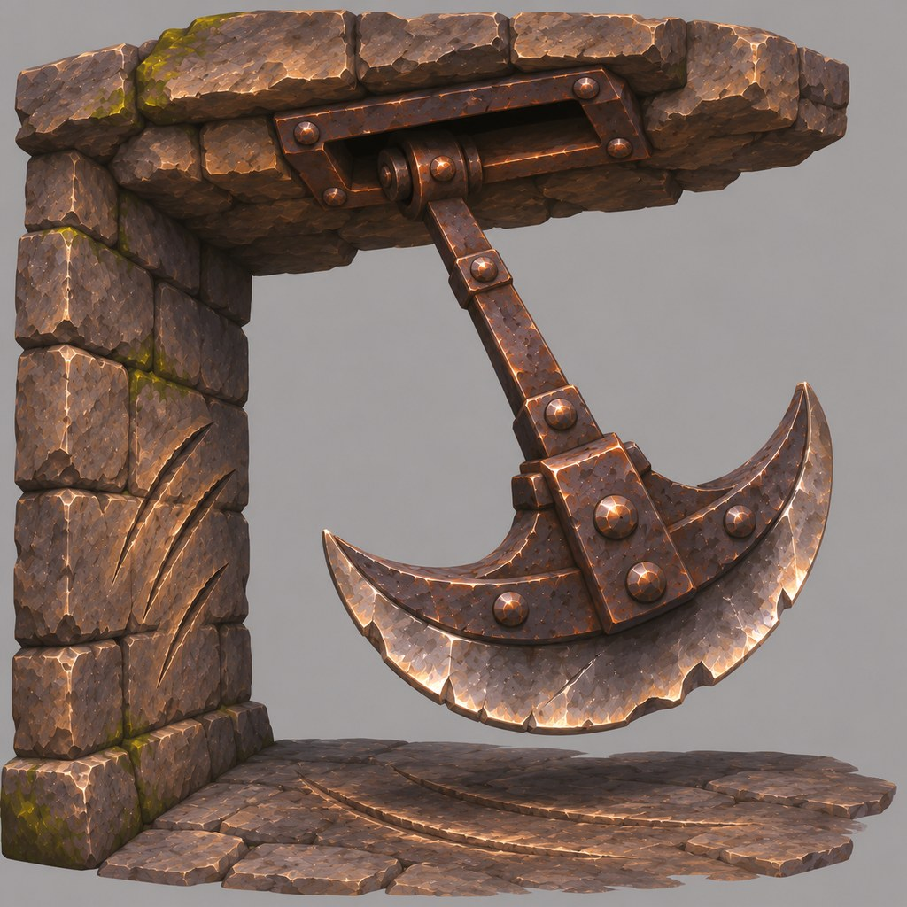

# Pendulum blade + ceiling slot (`trap_pendulum_blade`)

**Dungeons:** ⭐ Brassgate Vault (Pendulum Hall), The Hammerfall Works (Bridge of Chains).
**What it does:** a big blade swings side to side across the path. Deadly. **Clue:** a whoosh, cuts in the walls. **Safe way:** time the gap, or shoot the rope.

## Size (2 m grid)
- Ceiling piece: **2 × 2 m**, with a slot 1.6 m long, 0.12 m wide.
- Bar 2.6 m from the pivot to the blade; blade 1.2 m wide crescent, its edge 0.3 m above the floor at the low point (ceiling 4 m).

## Parts and what moves
| Part name | What it is | Moves? |
|---|---|---|
| `ceiling` | the ceiling slab with the slot | stays |
| `swing` | pivot axle, bar (or rope-wrapped bar), blade | **swings** ±50° along the slot, pivot at (0, 3.9 m, 0), axis z; 2.4 s per full swing |
| `cuts` | a wall decal of thin cuts for the walls beside it | stays |

## Start from
- Ceiling: `stonehold_v2.py` flat roof/floor slab; blade: `items_tools.py` axe-head shapes, made huge.

## Colours
- Stone: Stonehold cut stone (4 grey tones, dark mortar), dark iron bands.
- Blade: dark iron with a brighter nicked edge; brass trim in the Vault (1 in 8 rule).

## MODEL-RULES checks that matter
- **Rule 1:** built by script; side-by-side picture with this concept before it's done.
- **Rule 2 (no shimmer):** moving parts keep at least 1 cm clear of the fixed parts in every position (check the start and the end pose).
- **FLOAT:** every part touches the rest (chain links touch each other, rivets touch plates).
- **Placement rule:** nothing the cave grows may stand in its moving area; add a keep-out test when it's placed.
- The bar stays 2 cm clear of the slot sides through the whole swing.

## Picture vs. this sheet
The picture is concept art for the look only. Sizes, parts and doors follow this sheet (whole 2 m squares, the existing round door).
