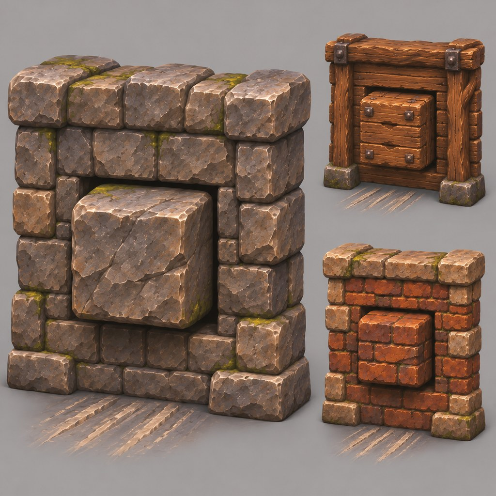

# Push wall (`trap_push_wall__plank_root`, `__cut_stone`, `__clay_brick`) + floor scrape decal

**Dungeons:** ⭐ Old Pell's Diggings (Rotten Gallery, wood), Brassgate Vault (Coin Chute), Emberdeep (Bellows Walk), Hammerfall (Gearworks), Cinderhold (Upper Gantry).
**What it does:** a block slams out of the wall and shoves you sideways into a chasm or onto rotten floor over spikes. **Clue:** pale scrape marks on the floor, a dark gap round the block. **Safe way:** crouch-walk along the far wall, or step on its plate and jump back.

## Size (2 m grid)
- A normal **2 × 2 m wall piece, 0.3 m deep** per style.
- The block: 1.4 m wide × 1.4 m tall, bottom 0.2 m above the floor; sits flush (1 cm back) until it fires.
- Scrape decal: 1.6 × 1.2 m on the floor in front, 1 cm above the floor.

## Parts and what moves
| Part name | What it is | Moves? |
|---|---|---|
| `frame` | the wall with the square hole | stays |
| `block` | the pushing block (planks, a stone, or bricks on a stone back) | **slides out** along z: 0 → 1.2 m in 0.25 s, stays 1 s, back in 2 s |
| `scrape` | the floor decal | stays |

## Start from
- Wood: `dungeon_rootwood.py` `wall_frame3()` / `dart_wall()`. Stone: `stonehold_v2.py` wall. Brick: `kit_zone1.py` wall with `clay_brick`.
- Cut a 1.42 m hole; the block is the same wall material, 1.2 m deep behind (dark backing on its sides).

## Colours
- Wood: root-wood bark and planks (Shack `shackbark`, `shackplank`, `shacklogend`), rope picture, dark iron.
- Stone: Stonehold cut stone (4 grey tones, dark mortar), dark iron bands.
- Brick: Hearthbrick warm red-brown bricks (4 tones, dark mortar), pale limestone trim, dark iron.
- The block's sides that show when it's out: the dark backing colour.

## MODEL-RULES checks that matter
- **Rule 1:** built by script; side-by-side picture with this concept before it's done.
- **Rule 3 (building piece):** clean layers (backing, material, trim, decor); nothing past the outline; outer faces 0.5 cm inside it; lines up with the kit's normal piece beside it (picture of both).
- **Rule 2 (no shimmer):** moving parts keep at least 1 cm clear of the fixed parts in every position (check the start and the end pose).
- **Rule 6:** neighbouring planks, stones or bricks use different paintings; nothing stretched.
- Rule 3 here: the material is cut exactly to the hole's edge on the wall and the block.

## Picture vs. this sheet
The picture is concept art for the look only. Sizes, parts and doors follow this sheet (whole 2 m squares, the existing round door).
