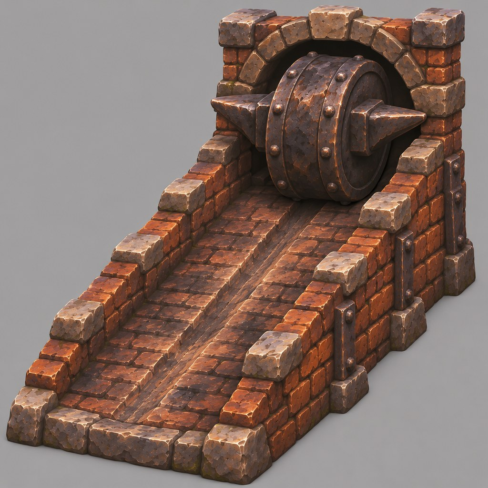

# Rolling anvil (`trap_roll_anvil`)

**Dungeons:** ⭐ Emberdeep Forge (Rolling Ingot Ramp).
**What it does:** the forge version of the rolling boulder: a huge round iron weight rolls down a brick ramp. Deadly. **Clue:** a long groove, a dark hole high in the wall. **Safe way:** run to a side alcove.

## Size (2 m grid)
- The weight: a fat iron drum 1.8 m across, 1.2 m wide, with an anvil horn shape cast on each flat side, the horns kept inside the 1.8 m size.
- Ramp, hole and alcove: same as the rolling boulder, in brick (`ramp_groove__clay_brick`, `wall_alcove__clay_brick`).

## Parts and what moves
| Part name | What it is | Moves? |
|---|---|---|
| `weight` | the iron drum | **rolls** round its axle (x), moved by the code |

## Start from
- Shape from `anvil.py` (the horn and the base); the rest from the `trap_roll_boulder` sheet in `kit_zone1.py` brick.

## Colours
- Forge: dark iron, soot-stained brick and stone, brass only as small trim; molten metal = the existing glow colour.

## MODEL-RULES checks that matter
- **Rule 1:** built by script; side-by-side picture with this concept before it's done.
- **Rule 6:** neighbouring planks, stones or bricks use different paintings; nothing stretched.
- Rule 2: rest spot 2 cm off the floor.
- Roundness: the rolling surface must be round enough to roll smoothly (16+ sides), but still chunky and a bit uneven in paint.

## Picture vs. this sheet
The picture is concept art for the look only. Sizes, parts and doors follow this sheet (whole 2 m squares, the existing round door).
