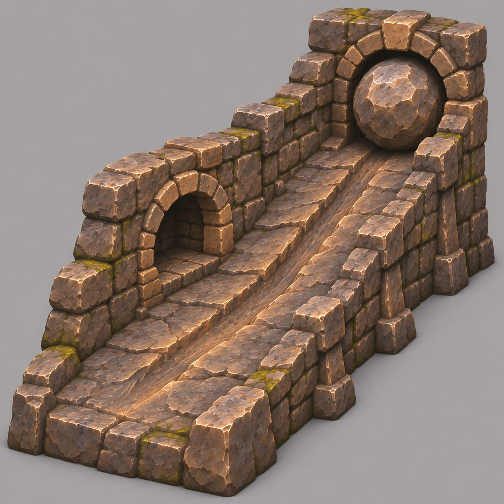

# Rolling boulder + groove ramp + side alcove (`trap_roll_boulder`, `ramp_groove`, `wall_alcove`)

**Dungeons:** ⭐ The Quiet Barrows (Long Barrow).
**What it does:** a boulder drops out of a hole high in the wall and rolls down the slope after you. Deadly. **Clue:** a long groove down the floor, a dark hole high in the end wall. **Safe way:** run to a side alcove.

## Size (2 m grid)
- Boulder: 1.8 m across (fills most of the 2 m corridor).
- `ramp_groove`: a **2 × 2 m sloped floor piece** (drops 0.5 m), groove 0.6 m wide, 8 cm deep; tiles along the corridor.
- `wall_alcove`: a 2 × 2 m wall piece with a round-topped niche 1.0 m wide, 1.6 m tall, 0.8 m deep (a dwarf fits).
- The release hole: a 2 × 2 m end-wall piece with a round hole 1.9 m across, its bottom 1 m up.

## Parts and what moves
| Part name | What it is | Moves? |
|---|---|---|
| `boulder` | the boulder | **rolls** (code moves it down the groove and spins it round x) |
| `hole` | the end wall with the hole | stays |
| `ramp_groove` | floor pieces | stays |
| `wall_alcove` | the safe niche | stays |

## Start from
- Boulder: `cave_boulders.py` (round it more, chisel facets). Ramp and walls: `stonehold_v2.py` floor/wall blocks.

## Colours
- Stone: Stonehold cut stone (4 grey tones, dark mortar), dark iron bands.
- Groove: worn paler stone inside, polished by the boulder.

## MODEL-RULES checks that matter
- **Rule 1:** built by script; side-by-side picture with this concept before it's done.
- **Rule 3 (building piece):** clean layers (backing, material, trim, decor); nothing past the outline; outer faces 0.5 cm inside it; lines up with the kit's normal piece beside it (picture of both).
- **Rule 6:** neighbouring planks, stones or bricks use different paintings; nothing stretched.
- Rule 2: the boulder stays 2 cm above the groove floor in its rest spot (it starts in the hole).
- The alcove must fit a dwarf + 10 cm all round (test with the dwarf's capsule).

## Picture vs. this sheet
The picture is concept art for the look only. Sizes, parts and doors follow this sheet (whole 2 m squares, the existing round door).
