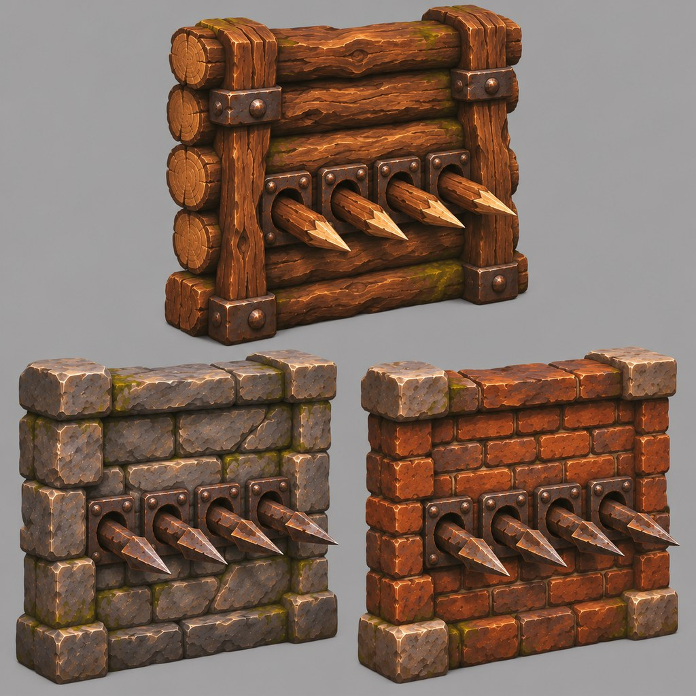

# Spear wall (`trap_spear_wall__plank_root`, `__cut_stone`, `__clay_brick`)

**Dungeons:** Pell's (Cave-in Tunnel, wooden stakes), Mossprop (Far Ledge), Barrows (Spear Gate), Shieldbearers (Barracks Row), Vigil (Broken Bridge).
**What it does:** spears stab out of wall holes and pull back. Hurts. **Clue:** rows of holes, one rusty tip showing. **Safe way:** crawl low, or go when they pull back.

## Size (2 m grid)
- A normal **2 × 2 m wall piece, 0.3 m deep**.
- Two rows of 5 holes at 0.6 m and 1.1 m up (crawling under 0.4 m is safe). Spears stick out 0.8 m.

## Parts and what moves
| Part name | What it is | Moves? |
|---|---|---|
| `frame` | the wall with the holes | stays |
| `spears` | all 10 spears (wood: sharpened stakes; stone/brick: iron spear tips on shafts) | **slide out** along z: −0.05 → 0.8 m in 0.15 s, back in 0.6 s |

## Start from
- Wood: `dungeon_rootwood.py` `dart_wall()` (bored holes with `bore()`) and the `trap_spikes` stakes. Stone/brick: the kit's walls with the same holes.

## Colours
- Wood: root-wood bark and planks (Shack `shackbark`, `shackplank`, `shacklogend`), rope picture, dark iron.
- Stone: Stonehold cut stone (4 grey tones, dark mortar), dark iron bands.
- Brick: Hearthbrick warm red-brown bricks (4 tones, dark mortar), pale limestone trim, dark iron.
- Tips: rusty iron; one tip shows a little in its hole at rest (the clue).

## MODEL-RULES checks that matter
- **Rule 1:** built by script; side-by-side picture with this concept before it's done.
- **Rule 3 (building piece):** clean layers (backing, material, trim, decor); nothing past the outline; outer faces 0.5 cm inside it; lines up with the kit's normal piece beside it (picture of both).
- **Rule 2 (no shimmer):** moving parts keep at least 1 cm clear of the fixed parts in every position (check the start and the end pose).
- The holes are cut cleanly through the material layer; spears stay 1 cm clear of the hole sides.

## Picture vs. this sheet
The picture is concept art for the look only. Sizes, parts and doors follow this sheet (whole 2 m squares, the existing round door).
