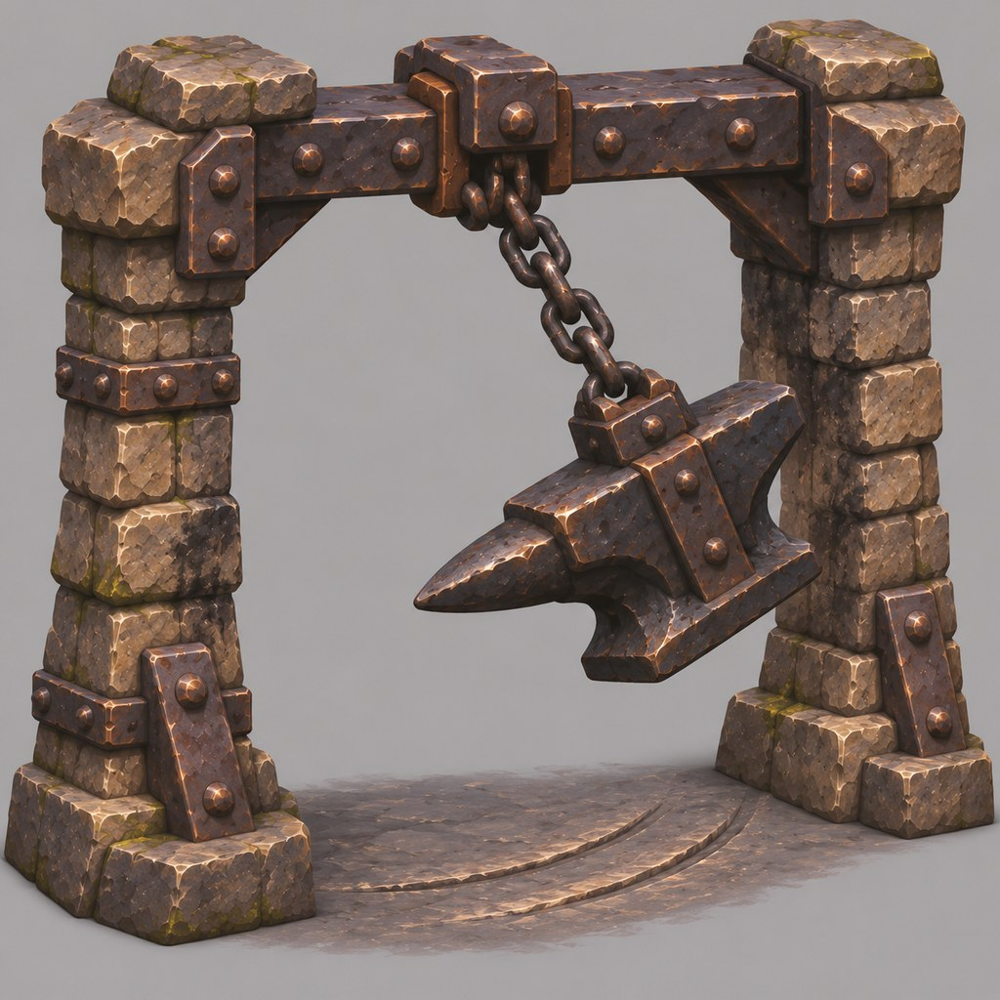

# Swinging anvil (`trap_swing_anvil`)

**Dungeons:** Emberdeep Forge (Hammer Row), The Hammerfall Works (Gatehouse Tunnel).
**What it does:** the forge version of the swinging boulder: an anvil on a chain swings across the path; ragdoll hit. **Clue:** curved scrape grooves on the floor, chain creak. **Safe way:** time it, or shoot the chain.

## Size (2 m grid)
- Same frame size as the swinging boulder: **4 m wide × 4 m tall × 1 m deep**.
- Anvil: 1.0 m long, 0.5 m tall; bottom 0.5 m above the floor at the low point. Chain 2.4 m.

## Parts and what moves
| Part name | What it is | Moves? |
|---|---|---|
| `frame` | two stone pillars, an iron-banded beam, rivets | stays |
| `swing` | chain + anvil | **swings** ±60° across the path, pivot at the beam's underside (0, 3.75 m, 0) |
| `chain_top` | eye plate + top 3 links | stays (the chain breaks below it when shot) |
| `scrape` | two curved floor grooves (decal) | stays |

## Start from
- `trap_swing_boulder` sheet (same frame layout and chain); `anvil.py` for the anvil shape.
- Pillars: `stonehold_v2.py` blocks, soot-darkened.

## Colours
- Forge: dark iron, soot-stained brick and stone, brass only as small trim; molten metal = the existing glow colour.
- Anvil: the anvil station's dark iron with bright worn edges.

## MODEL-RULES checks that matter
- **Rule 1:** built by script; side-by-side picture with this concept before it's done.
- **Rule 2 (no shimmer):** moving parts keep at least 1 cm clear of the fixed parts in every position (check the start and the end pose).
- **FLOAT:** every part touches the rest (chain links touch each other, rivets touch plates).
- **Placement rule:** nothing the cave grows may stand in its moving area; add a keep-out test when it's placed.

## Picture vs. this sheet
The picture is concept art for the look only. Sizes, parts and doors follow this sheet (whole 2 m squares, the existing round door).
