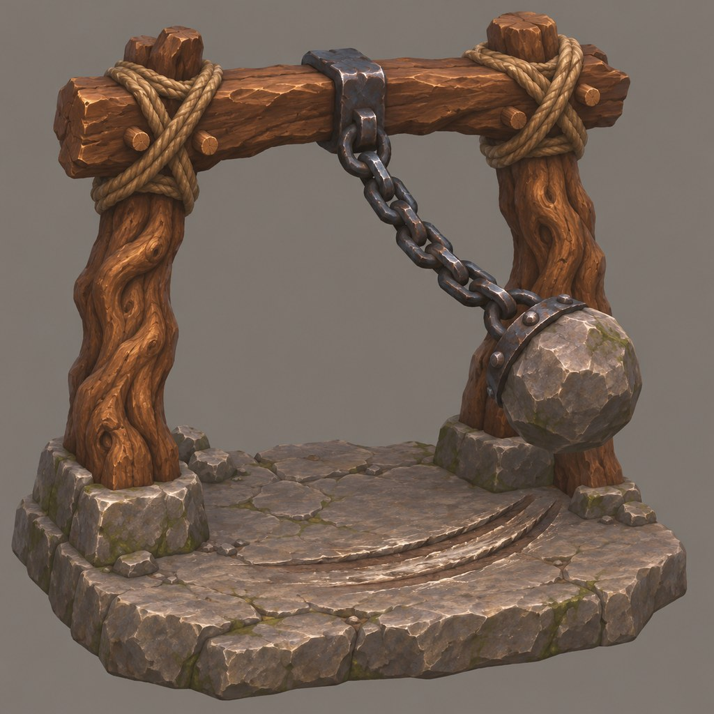

# Swinging boulder (`trap_swing_boulder`)

**Dungeons:** Lampwick Drift (The Old Shaft), ⭐ Mossprop Workings (over the plank bridge), The Quiet Barrows (Ash Bridge).
**What it does:** a boulder on a chain swings across the path. A hit throws you as a ragdoll (off the bridge, if
there is one). **Clue:** two curved scrape grooves in the floor, a creaking chain. **Safe way:** time the gap, or shoot
the chain (the boulder drops and rolls a little, then stays).

## Size (2 m grid)
- Whole trap: **4 m wide × 4 m tall × 1 m deep** (2 grid squares wide, sits across a 2 m path).
- Boulder: about 1.0 m across, bottom 0.5 m above the floor at the low point (hits a dwarf's chest).
- Chain: 2.4 m from the beam to the top of the boulder.
- Posts: 0.4 m thick, kept inside the 4 m width (nothing pokes past the outline).

## Parts and what moves
| Part name | What it is | Moves? |
|---|---|---|
| `frame` | two root-wood posts on stone footings, the crossbeam, rope lashings, pegs | stays |
| `swing` | chain + boulder together | **swings** round the chain's top link: pivot on the beam's underside, centre (0, 3.75 m, 0). ±60° side to side, across the path (along x) |
| `chain_top` | the iron eye bolt and plate under the beam | stays (the shootable spot is the chain just below it) |
| `scrape` | the two curved grooves (a thin floor decal 1 cm above the floor) | stays |

When the chain is shot, the code lets `swing` fall: the boulder keeps the bottom 0.4 m of chain hanging from it, so
build the chain as **links**, the top 3 links in `chain_top`'s group so they stay on the beam.

## Start from
- `tools/asset_forge/builds/dungeon_rootwood.py`: `crusher()` (beam, posts, chain helper `chain()`) and `entrance()`
  (big bark posts on stone footings, lashing, pegs). Same root wood as the Mossgate Hold kit.
- Boulder: `cave_boulders.py` (the cave's own boulders, chisel-cut and painted the Rock Beetle way).
- No pack model needed.

## Colours (wood)
- Posts and beam: root-wood bark (Shack `shackbark`, `shacklogend` pictures), pale axe-cut log ends.
- Rope: the kit's rope picture. Chain and eye bolt: dark iron (`chain_hanging_iron`).
- Boulder: the cave rock family (grey-brown), a few lighter worn ridges; footings: Shack stones (`shackstone`).
- Scrapes: the floor colour, a bit lighter and paler inside the groove.

## MODEL-RULES checks that matter
- **Rule 1:** built by script, side-by-side picture with this concept before it's done.
- **Rule 2 (no shimmer):** the chain links must not overlap each other's faces; the eye plate sits 1 cm proud of the
  beam or is joined; the scrape decal 1 cm above the floor, never on it.
- **FLOAT:** every link touches the next; the boulder touches the last link; lashings touch post and beam.
- **Rule 6:** each post and the beam use a different bark painting; log ends chopped, not ring "targets".
- Placement rule: nothing the cave grows may stand in its 4 × 2 m swing area (needs a test when it's placed).

## Picture vs. this sheet
The sheet's sizes win. In the picture the boulder looks too small (make it 1 m) and the frame stands on a stone
platform: leave the platform out, the trap stands on the dungeon floor.
